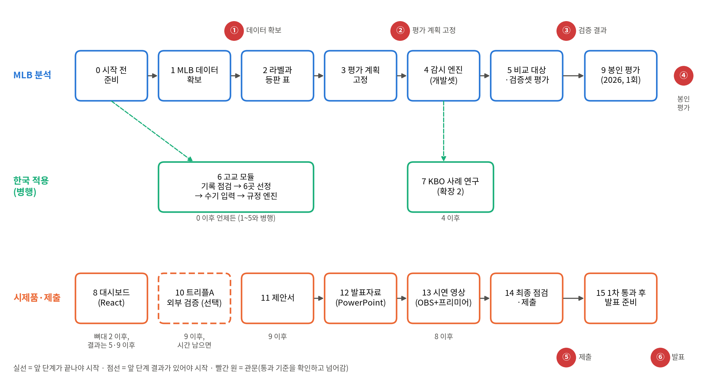

# PitchSignal

Early-warning signals for pitcher arm-injury risk — from MLB pitch tracking to Korean high-school scoresheets.

**Paper:** *One Step Past the Box Score: Pitcher-Safety Signals the Official Record Leaves Out, from Korean High School Scoresheets to Statcast* — accepted (conditional), Wharton Sports Analytics Research Journal, Fall 2026
**Dashboard:** https://robinkim0221.github.io/pitch-signal/
**Author:** HyeongJun Kim (UNIST) · robin1967@unist.ac.kr

> PitchSignal does not diagnose or predict injuries. A statistical monitor raises a signal to start a check; people make the call.



## How it works

- **A baseline per pitcher.** Each pitcher's own "normal" velocity and delivery is learned and updated after every outing.
- **Two signals when an outing drifts.** The main signal is a one-sided EWMA on velocity that fires only when velocity keeps coming in below the pitcher's expected level (a velocity drop). A secondary form-change signal applies multivariate control charts (variable-sample T² and MEWMA) to delivery features. Both are tuned so a healthy pitcher sees about one false alarm per 100 outings.
- **High-school games too.** Official high-school records have no ball/strike data, so a model reads photos of handwritten scoresheets to recover pitch-by-pitch results.
- **Rules fixed before results.** Hypotheses and decision rules were made public on GitHub before the results were seen, and the held-out 2026 season was evaluated only once.

## Results

| Measure | Result |
|---|---|
| False alarms (validation, MLB 2024–2025) | 0.85 per 100 outings (designed for 1) |
| Arm-injury IL within 30 days after a velocity-drop alert* | 10.5% vs 4.8% without an alert (2.2×, validation) · 9.8% vs 4.9% (2.0×, held-out 2026) |
| Handwritten scoresheets read | 3,906 photos · ball-rate error 1.3 percentage points against game video |

\* A follow-up measure added after the pre-registered plan. The held-out 2026 evaluation was smaller and weaker than validation on the main hypotheses; the paper discusses these limits.

## Getting started (Windows)

```powershell
# Python 3.12+ (tested on 3.13), Git, Node.js LTS
py -m venv .venv
.venv\Scripts\Activate.ps1          # if blocked: Set-ExecutionPolicy -Scope CurrentUser RemoteSigned
pip install -r requirements.txt
python -m pytest -q                 # all tests should pass
```

Work runs in numbered steps that follow the spec in `docs/SPEC.md` and the settings in `config.yaml`, passing five gates: data → evaluation plan fixed → validation results → held-out evaluation → submission.

## Repository layout

| Path | Contents |
|---|---|
| `config.yaml` | All choices and numeric settings (unchanged after the evaluation plan was fixed) |
| `config_scout.yaml`, `config_kbsa.yaml` | Scouting-check list; conversion of 2025–2026 high-school records and scoresheet-reading settings (kept apart from evaluation settings) |
| `docs/SPEC.md` | Specification |
| `docs/HANDOVER.md` | Current state and how to continue the work |
| `src/core/` | Verified reference implementation (do not modify): core statistics, high-school rule engine |
| `tests/` | Tests for the reference implementation |
| `tools/sim_short_outings.py` | Simulation comparing ways to handle short outings |
| `templates/` | Excel templates for high-school record checks and pitch-count entry; evaluation-plan form |
| `.github/workflows/deploy-pages.yml` | Deploys the dashboard to GitHub Pages |

## Data and terms of use

- MLB Statcast (Baseball Savant) and the MLB Stats API: non-commercial research only; raw data is not stored in this repository.
- Korean high-school records (official 2025–2026 game records from the KBSA record room, collected once per season; originals not shared): schools and players appear under the names shown in the record room (players as "name #number"). The name lookup table stays outside the repository and is joined only when building dashboard data.
- Handwritten scoresheet photos (2025–2026, 3,906 images): used only for reading; not uploaded to the repository or the site.
- Only code, settings, aggregated results, and summary JSON for the dashboard are public.
